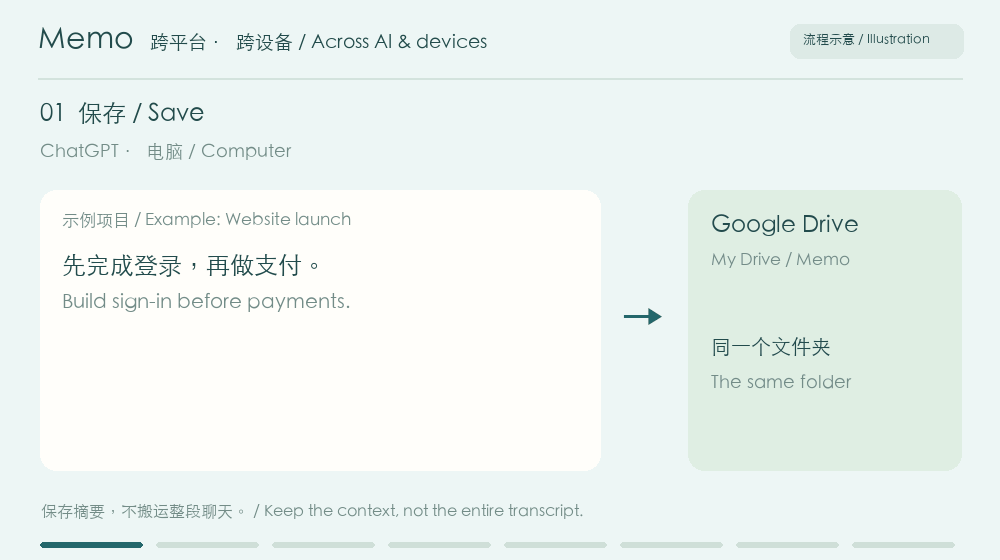

# Memo

Save and find conversation context across **ChatGPT, Claude, Gemini and devices**, using your own Google Drive.
通过自己的 Google Drive，**跨 AI 平台、跨设备保存和找回讨论内容**。

*Illustrative workflow, not a live platform recording. / 流程示意，非真实平台录屏。*

[English guide](https://pauline-zhang-star.github.io/Memo/) · [中文说明](https://pauline-zhang-star.github.io/Memo/zh/)

## Setup in 3 steps / 三步配置

1. **Choose your platform and get its rules. / 选择平台，获取对应规则。**
   Open the [ChatGPT](platforms/chatgpt/memo/SKILL.md), [Claude](platforms/claude/memo/SKILL.md), or [Gemini](platforms/gemini/memo/SKILL.md) file and download `SKILL.md` using GitHub's raw-file download. / 打开对应平台的文件，通过 GitHub 原始文件下载保存 `SKILL.md`。

2. **Sign in, import and enable Memo. / 登录平台，导入并启用 Memo。**
   Claude and Gemini: use the Skills import/create interface available in your account. ChatGPT: if plugin import is available, package the ChatGPT rules at `skills/memo/SKILL.md` with this repository's `plugin.json` and `assets/`, then import and install the plugin. Select Memo in your conversation. See the [platform-specific steps](https://pauline-zhang-star.github.io/Memo/#install). / Claude、Gemini 通过账号提供的技能导入或创建入口配置；ChatGPT 若提供插件导入，将对应规则放到 `skills/memo/SKILL.md`，连同 `plugin.json` 和 `assets/` 打包后导入安装。随后在对话中选中 Memo。[分平台详细步骤](https://pauline-zhang-star.github.io/Memo/zh/#install)。

3. **Connect Google Drive and try it. / 连接 Google Drive，试着保存和找回。**
   Use `/memo` to save the visible discussion. In a new supported chat or on another device, select Memo and enter `/memo topic` to find it. Use the same Google account or an explicitly shared Memo folder. / 输入 `/memo` 保存当前讨论；在支持的新对话或另一台设备上选中 Memo，输入 `/memo 主题` 找回。各平台使用同一 Google 账号，或已明确共享的 Memo 文件夹。

## Use / 使用

| Command / 输入 | Result / 用途 |
| --- | --- |
| `/memo` | Summarize and save the visible discussion. / 总结并保存当前可见讨论。 |
| `/memo topic` | Search and read matching saved summaries. / 搜索并读取相关主题的已有摘要。 |

Invocation depends on the platform: use its Memo skill/plugin selector, `/memo`, or `@memo` where supported. These text conventions do not register native commands. / 调用方式以平台定义为准：使用 Memo 技能／插件选择器，或平台支持的 `/memo`、`@memo`；文本约定本身不会注册原生命令。

## Requirements / 使用条件

- Drive search and reading tools are needed for retrieval; saving also needs real document-writing or export tools. / 检索需要 Drive 搜索和读取，保存还需实际的正文写入或导出能力。
- The default destination is a `Memo` folder in your Drive. Mobile support varies by platform and available tools. / 默认使用 Drive 中的 `Memo` 文件夹；手机端支持情况取决于平台和可用工具。
- A save is verified only after the body is read back; folder location is checked separately. / 保存需读回正文核验，存储位置另行核对。
- Keep credentials and personal destination settings out of public rule files. / 不要向公开规则提交凭证或个人文件夹配置。

## Optional installer / 可选安装器

Prefer automatic setup? Memo Setup is a separate paid installer; sign-in and authorization still require your participation. The free skill works independently. / 不想逐个平台手动配置？可选择单独收费的 Memo Setup 自动安装器，登录与授权仍需自行完成。免费 skill 可独立使用。

Installer binaries, installer source code and personal packages are not included in this repository. / 本仓库不包含安装包、安装器源码或个人安装包。

Version / 规则版本：**0.4.18**. Memo is an independent project, not an official product of OpenAI, Anthropic or Google. / Memo 是独立项目，并非 OpenAI、Anthropic 或 Google 的官方产品。
